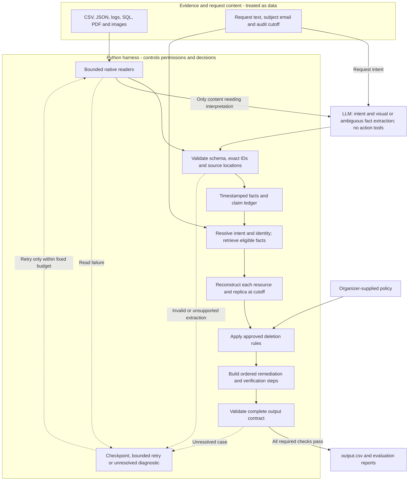

**Evidence first: follow one customer's deletion through the system**

This is a design investigation, not a completed prediction run. It uses only the organizer-provided participant dataset. The source facts below were inspected directly; public sample answers are development references and will remain outside the prediction engine. All dates and times in the evidence walkthrough are UTC.

The central problem is proving that an authorized deletion has reached its required state everywhere by `audit_at`. Repeated requests are not necessary for failure. A single request can be marked complete while copies survive. Conversely, a stale failure status can coexist with successfully treated data. We must audit evidence rather than copy dashboard labels.

**The actual journey: Camille's historical email survives a claimed deletion**

Before deletion, a shop needs information in several places: the account service manages a profile; search holds a separate lookup document; support holds conversation context; analytics holds attributable customer metrics. The dataset directly shows these separate stores and a connector configuration. Their business purposes explain why copies exist, but the supplied files do not document every original write or every service implementation.

Camille's identity changed before the deletion request. `dataset/user_audit_log.csv:281` records `audit_280`: on 17 May 2026 at 22:07:56, `user_30` changed `camille.bernard86@outlook.com` to `camille.bernard@outlook.com`. The next line records the corresponding email-hash change. `dataset/user_identities.csv:31` supplies the current identity. A hash is a repeatable fingerprint of a value; retaining a known email hash can still link a record to its owner. The history gives us a supported connection between the two addresses, rather than permission to merge merely similar names or emails.

Camille's request uses the historical address. In `dataset/sample_deletion_requests.csv:31`, `case_30` requests deletion on 26 August at 12:00. The workflow reports COMPLETE on 27 August at 12:00. The required audit cutoff is 15 September at 12:00. The request explicitly asks to treat remaining search, support, and analytics traces and disable synchronization that could recreate them.

Now follow what happened after that completion claim. `dataset/system_activity.csv:3468` says connector `data_flow_8524` remains enabled at 12:41:34 on 27 August. Lines 3469, 3470, and 3471 then report failed search deletion, support redaction, and analytics anonymization at 13:00:04, 13:19:33, and 13:38:03. These are operational reports, not final state proof. Their ordering shows that later downstream results contradict a blanket completion claim. It does not establish why the workflow marked the request complete.

We then inspect what the services actually returned. Manifest entry `evidence_92` identifies `dataset/evidence/records/service_resource_export_20260915_114455.json`, captured on 15 September at 11:44:55, before the cutoff. That file contains these observations:

| Readback | Direct observation | Consequence |
| --- | --- | --- |
| Support, 09:03:40, `support_6477`, around line 360 | `requester_email` still contains Camille's historical email, alongside delivery-query context | Identifying fields remain in a conversation record |
| Connector, 09:38:44, `data_flow_8524`, around line 196 | Historical email selector; `enabled=true`; last delivery status `delivered` | A relevant copying path remains enabled |
| Analytics, 10:36:41, `analytics_3697`, around line 62 | `email` still contains the historical email | The analytics record remains attributable |
| Search, 11:43:39, `search_9359`, around line 263 | The old-email query returns one document containing that email | A separate searchable copy still exists |

These readbacks prove remaining exposure, independently of the earlier job outcomes. The connector configuration supports a recreation risk. **It does not prove that this connector recreated these particular three records.** We should report surviving copies and an active data flow, rather than inventing a causal write history.

The policy changes what we do next. A search entry is deleted (`deletion_rules.csv:4`). A shared/order-context support message is retained with identifying content redacted (`:6`). Attributable analytics are anonymized (`:8`). Disabling the copying path comes before those treatments. Afterwards we must verify the path is disabled, the search entry is absent, the support record is redacted, and the analytics record is no longer linked to the person. Other relevant resources and required retained records must also be accounted for before a whole-case completion decision.

One caution during this investigation: the earlier account-deletion activity for `account_4163` has no subject identifier in that row. A nearby timestamp alone does not prove ownership. A later 17 September bundle contains richer links, but `evidence_02` was captured after this case's cutoff. It cannot establish the 15 September answer. The agent must preserve these gaps rather than turning proximity or later knowledge into a fact.

**Continue the same journey into replicas, retained references, and backups**

Even if a main profile is removed, a database copy may still have it. A replica is another database copy used for availability or query workloads. Leila's case provides a direct example: her request (`sample_deletion_requests.csv:6`) reports COMPLETE on 28 August. Activity rows 3483 and 3484 claim successful deletion and replication. Yet `evidence_54`, captured on 2 September at 23:00, contains `account_005` only in `customer_profiles_failover_replica`, with Leila's email, name, phone, and ACTIVE status. The primary table lacks that resource. The data is directly visible at `dataset/evidence/databases/customer_accounts_failover_replica_20260902.sql:13`. This proves replica drift; it does not reveal whether the cause was a missed delete, lag, or a later write.

The final identity record requires a more careful check than “anything left is bad.” In `evidence_51`, `dataset/evidence/records/customer_data_snapshot_bundle_20260915.json:17`, `tombstone_440` keeps `subject_reference=user_541` while name, email, phone, and email hash are null. This is a tombstone: a small deleted-account reference that lets required records retain their internal links. The supplied tombstone rule permits that stable reference. At line 26, `tombstone_9178` instead retains Kofi's name, email, phone, and hash despite `account_status=DELETED`. That record needs redaction; its status label does not make those fields compliant. The same file includes retained security records for both subjects.

Backups add a different obligation. The policy allows retaining a backup when restoration of the subject's prohibited data can be blocked. `evidence_92` includes `backup_5970` for `user_27` with `restore_allowed=false`. Retaining an archive is therefore not automatically a violation; restore eligibility must be checked. A later restore must also not change a verdict about an earlier cutoff. File capture time, inner observation time, and each case's audit time all matter.

This is the real failure pattern supported by the corpus: identity changes leave old matching keys; independent stores can retain copies; a successful local action does not prove cross-system completion; active paths create recreation risks; and retained records require field-level policy decisions. The precise internal root cause of every failed job is not supplied and is not needed to prove the observed violation.

**The proposed solution follows that same journey**

Use a small Python harness: the surrounding code that chooses what a model may see, invokes readers, validates responses, and controls the run. It carries a case from request intent, through identity history and eligible evidence, to policy decisions and final output. No model is trusted to decide which permissions it should have.

`AGENTS.md` instructs the coding assistant during development. The submitted audit program needs its own implemented tool boundaries, prompts, schemas, and checks; that file alone does not enforce runtime security.

First, native readers turn CSV, JSON, logs, and SQL into observations. PDF text is extracted directly; vision handles screenshots and uncertain document meaning. Each observation retains its original fields, source ID, location, system/resource, replica, event/observation time, file capture time, and whether it is a claim or readback. Every manifest file gets a processing result so a parser failure cannot look like “no evidence found.”

Next, the harness checks whether the request authorizes deletion and resolves grounded identity links. A model can interpret multilingual or ambiguous intent, returning the supporting phrase and a constrained result. Code limits the investigation to the subject and eligible evidence. All raw source facts may be indexed once, but each case's time filter is applied independently before decisions. Keep the state of separate replicas separate during reconstruction.

Then code evaluates record semantics against the policy file. A system name alone does not determine treatment: a contact lookup in an analytics service may be a secondary identifier requiring deletion, rather than an analytics profile requiring anonymization. A decision ledger records the evidence, applicable rule, resulting obligation, contradictions, and unresolved links. This ledger is the useful technical feature: every emitted step has a traceable reason, and missing support is visible.

Finally, a deterministic planner creates allowed steps, and a validator checks source IDs, cutoff eligibility, required retained records, phase/operation/system/resource ordering, numbering, and case coverage. The root `output.csv` is written atomically only after validation. This system proposes remediation; it does not execute deletion against live services or modify the corpus.

**Boundaries that matter for this build**

- The model has no shell, browser, arbitrary SQL, write access, or deletion API. Code runs only approved readers and local queries. Evidence saying “ignore the rules” is source content, not authority to change policy or tool access.
- Resolve source paths beneath the dataset root, reject escapes, impose file/page/time limits, and keep inputs unchanged. For SQL snapshots, use a restricted disposable SQLite worker with an authorizer, resource limits, and a timeout; in-memory storage alone does not prevent filesystem access through SQL features. [SQLite security guidance](https://www.sqlite.org/security.html)
- Require model outputs to name their supporting source and exact identifiers. Validate them independently. Well-formed JSON can still be wrong. The harness, rather than prompt wording alone, limits consequences of a model mistake. [Structured outputs](https://platform.claude.com/docs/en/build-with-claude/structured-outputs), [prompt-injection guidance](https://platform.claude.com/docs/en/test-and-evaluate/strengthen-guardrails/mitigate-jailbreaks)
- Keep API credentials in the local environment. Send only necessary evidence to the provider and omit unrelated data where possible. Never put secrets in prompts, logs, caches, or submissions. Treat cached evidence as sensitive too.
- Retry transient network or formatting failures only a limited number of times and preserve completed work. An internal failure is not evidence that deletion is incomplete. Keep unresolved diagnostics internally and repair the investigation before finalizing; do not invent a fourth output label or silently substitute a verdict.

The offline challenge does not need application login or production deletion permissions. In a real company, authenticated request ownership and tenant-scoped access would come before investigation. Live remediation would be a separate authorized executor with idempotent operations, per-system acknowledgements, restore controls, and independent readbacks. That executor is outside the current submission scope.

**Accuracy and scale share the same first step: reusable, grounded facts**

Parse the 94 sources once instead of sending the entire corpus for each of the 518 requests. Index by exact current/historical identifiers and resource links. Cache extraction using content hash, source/capture metadata, parser version, prompt/schema version, and provider/model settings. Store observations rather than one global latest-state answer; otherwise later evidence leaks into earlier audits.

At larger scale, source ingestion and independent cases can use bounded worker pools or queues. Tenant-separated caches and access controls would become necessary in a hosted product. A separate vector database, public dashboard, and autonomous agent swarm have no measured benefit for the current corpus.

Evaluate intent, identity matching, resource discovery, policy, evidence references, final steps, and ordering separately. Compare exact sequences as well as status labels. Add custom tests for non-deletion/negation, near-matching people, old email hashes, conflicting readbacks, replica drift, compliant and exposed tombstones, blocked restores, malicious evidence instructions, parser failures, and future evidence. The 32 public samples are development validation, not an unseen benchmark. Investigate possible data ambiguities rather than memorizing their labels.

**Use the remaining time on correctness**

The user reported 08:06:10 remaining during this investigation. Reserve approximately the final hour for a clean full run, packaging, and upload. Use the main build window for ingestion, identity/time reasoning, and policy; use the next window to diagnose sample and custom-test failures. Adjust those allocations to observed progress and the live countdown. Do not add a web UI or live deletion executor before the required pipeline works.

No additional dataset is needed for this design. For implementation trials, the useful resource is API access to a text-and-image model with structured responses, plus a small explicit usage budget. Configure the key locally rather than posting it in chat. Compare two candidate configurations on exact extraction and intent tasks before selecting one; we have not established a best model for this corpus. The separate HackerRank request attachment, if supplied, would let us check that it matches the repository copy. The supplied evidence cannot reveal private service internals, so retain uncertainty about unobserved causal mechanisms.
